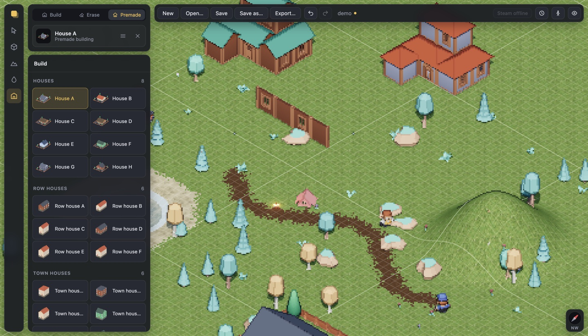
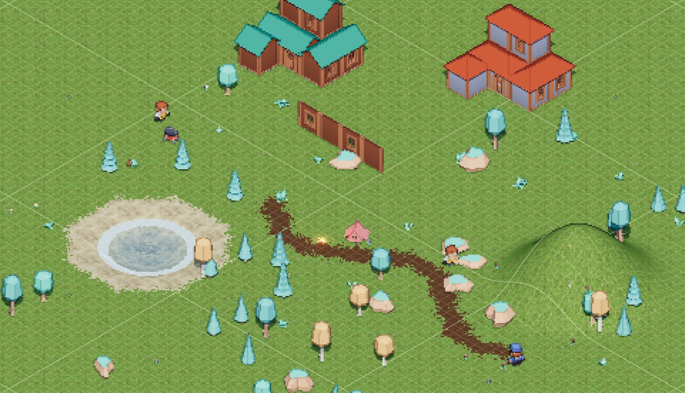
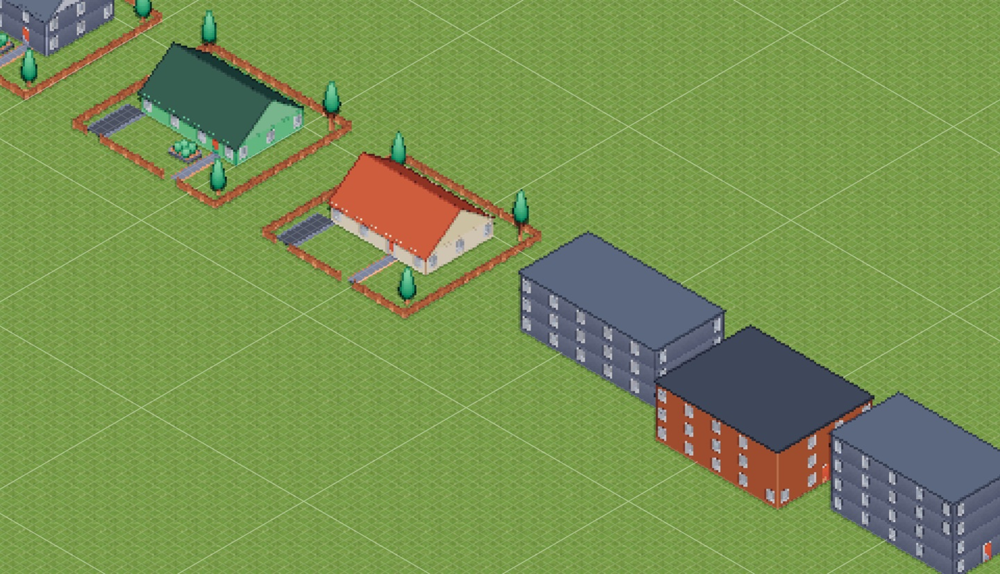
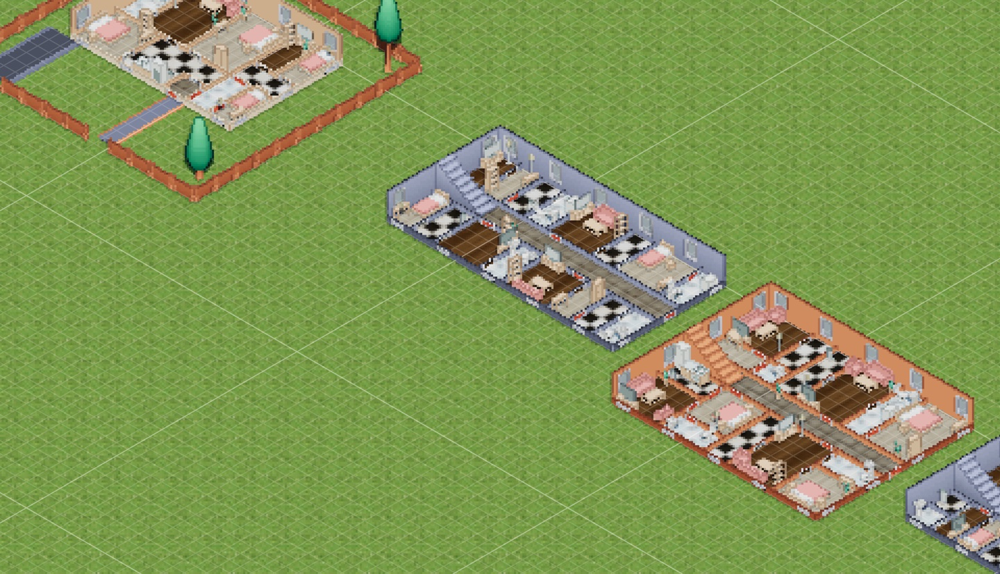

# Pixel Arena

A desktop map editor for building 3D maps rendered as pixel art (or through other stylized
filters). Place props from a large searchable library, sculpt and paint terrain, add water, and
put up modular or premade buildings with furnished interiors.

Built with TypeScript + three.js and a Svelte UI; ships as an Electron app (macOS, Windows) with
Steam integration. Maps (`.pxmap`) can also be opened in a browser.

**Try it in the browser:** https://davudk.github.io/pixel-arena/?map=fixtures/demo.pxmap

| Generated buildings | Furnished interiors (cutaway) |
| --- | --- |
|  |  |

## Features

- Unbounded, chunked map with heightmap terrain: sculpt, paint materials, water and other liquids.
- Prop library from CC0 / CC-BY packs (`packs/`), with categories, themes and search.
- Building Kit (floors, walls, rooms, doors, windows, wall styles) and a library of premade,
  furnished buildings; a cutaway view shows interiors floor by floor.
- Transaction-based editing: undo/redo and history branches.
- Swappable post-process filters (pixel, CRT, Game Boy, oil painting, gothic, …), time of day,
  and exports from preset angles or top-down.

## Running

- Desktop app: double-click `Run Pixel Arena.command` (installs dependencies on first run,
  builds and starts Electron).
- In a browser: `npm run dev --prefix web`, then open http://localhost:5200
  (try `?map=/fixtures/demo.pxmap`).
- Tests: `npm test --prefix web`. Type-check: `npm run check --prefix web`.
- Packaging: `npm run package --prefix web` writes unsigned builds to `web/desktop/out/`.
- Web build for GitHub Pages: `.github/workflows/pages.yml` runs on every push to `web-port`
  (`PAGES_BASE=/pixel-arena/ npm run build -w app` copies the packs and sample maps into
  `web/app/dist`).

More commands and project rules are in [CLAUDE.md](CLAUDE.md); the plan and architecture are in
[docs/PLAN.md](docs/PLAN.md), UI conventions in [docs/UI.md](docs/UI.md) and the building
system in [docs/BUILDINGS.md](docs/BUILDINGS.md).

## Layout

- `web/core` — `@pixel-arena/core`: the map document, ops and `.pxmap` codec (pure data, no DOM).
- `web/app` — the editor (three.js renderer, tools, Svelte UI).
- `web/desktop` — Electron shell and Steam integration.
- `web/tools` — pack importer and premade-building baker.
- `packs/` — prop packs (manifests + assets; attribution kept in each manifest).
