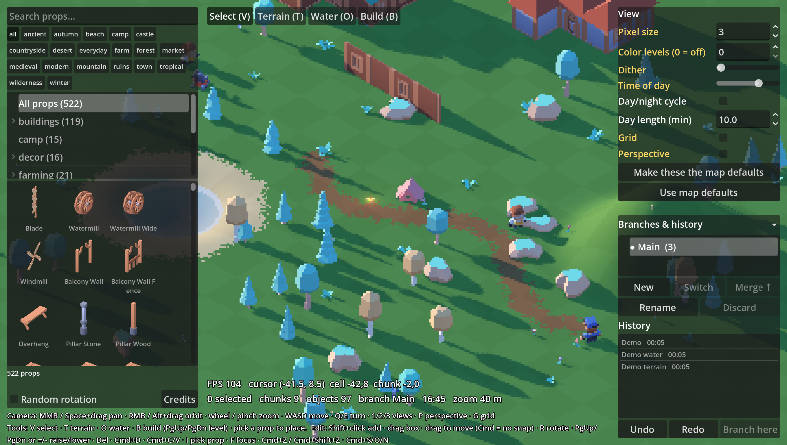
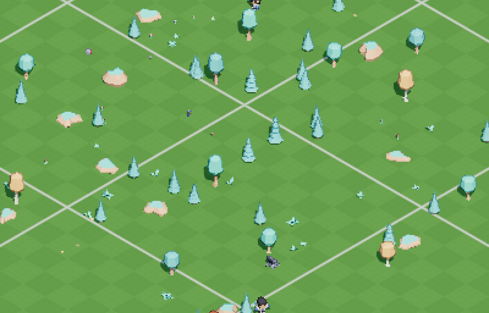
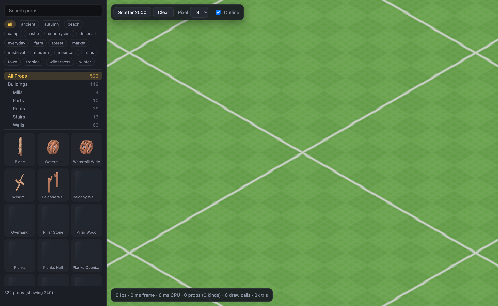

# Web stack spike — report

**Question:** should Pixel Arena move from Godot 4 (GDScript) to a web stack (TypeScript +
three.js, HTML/CSS UI, desktop via Electron) so the editor gets a better UI and shared maps can be
viewed natively in a browser?

**Short answer:** the web stack holds up. Performance matched Godot at 2,000 props, the pixel look
ported in ~150 lines and matches, and the HTML UI was faster to build and looks clearly better.
The cost is roughly as much work again as M0–M6. My recommendation is to port, starting with the
core data layer and its tests (see the end).

## What was built

`web-spike/` (≈1,200 lines: TypeScript, Svelte, CSS) — runs with `npm install && npm run dev`
(http://localhost:5199; `?bench` runs the benchmark below). It reads the **same `packs/`
folder** as the Godot app via a tiny Vite plugin.

| Piece | File | Notes |
|---|---|---|
| Pack/manifest loading, validation, license allow-list, category/theme/text search, snapping | `src/lib/library.ts` | Direct port of `PropLibrary`/`PropDef`/`Snapping` |
| glTF loading split into instanceable parts, BVH raycasting | `src/lib/models.ts` | `three-mesh-bvh`; Nature Kit metallic override applied |
| Pixel renderer: low-res target, nearest upscale, texel-snapped camera with sub-texel image offset, depth-Laplacian outline, ACES tone mapping | `src/lib/pixel.ts` | Port of `PixelView`/`CameraRig` + outline shader |
| Ground with 1 m grid / 32 m chunk lines / checker (injected into a lit material), sun with texel-snapped shadow box, instanced props, ghost placement with grid/subgrid/surface snapping | `src/lib/world.ts` | |
| Offscreen thumbnails | `src/lib/thumbs.ts` | |
| UI: prop browser (search, theme chips, category tree, thumbnail grid), toolbar, status | `src/App.svelte`, `src/app.css` | ~350 lines incl. styles |
| Benchmark | `src/lib/bench.ts` | Saves screenshots + JSON into `report/` |

Not built (out of scope or not approved): Electron shell (skipped at your request — see below),
terrain, water, buildings, selection/move tools, undo/branches, export.

## Look

| Godot (current app, `--demo`) | Web spike (same props, pixel size 3) |
|---|---|
|  |  |

UI: 

- The pixel pipeline (low-res render, nearest upscale, texel snapping, outlines) behaves the same.
  One gotcha found and fixed: pixel size must be in CSS points (× devicePixelRatio), like Godot's
  content scale, or Retina screens get half-size pixels.
- Colors differ only from lighting/tone-mapping tuning (Godot's demo here also has terrain, a
  different time of day and your saved view overrides). Getting exact parity is tuning work,
  not a blocker.
- Outlines are depth-only in the spike; Godot's also use normals. three.js can render a normal
  pass (or MRT) for crease lines — straightforward.
- Shadows: three's PCF shadow map with a texel-snapped box looks fine at editor zooms; very
  zoomed-out views will want cascades (three has a CSM addon).

## Performance (MacBook, Apple M5, 120 Hz, Chrome 155, ANGLE/Metal)

Same scatter in both: 2,000 props drawn from the same pool (trees, rocks, plants, flowers,
fences, characters, wood walls) over a 220 m square. Both apps are vsync-capped at 120 fps.

| Scene | Web: fps | Web: CPU ms/frame | Web: draw calls / tris | Godot: fps | Godot: draw calls / primitives |
|---|---|---|---|---|---|
| Empty | 120 | 0.3 | 1 / 2 | 120 | 170 / 7k |
| 100-prop demo | 119 | 1.4 | 142 / 31k | — | — |
| 2,000 props, zoom 40 m | 120 | 2.2 | 857 / 583k | 119.7 | 1,392 / 136k |
| 2,000 props, zoom 160 m | 120 | 2.2 | 859 / 583k | 120 | 2,343 / 435k |

(Raw: `report/bench-chrome.json`; screenshots `report/web-2000-*.png`, `report/godot-2000-*.png`.)

- Neither stack is near its limit at 2,000 props. The web version uses ~2 ms of a 8.3 ms frame.
- three.js instancing (one `InstancedMesh` per prop part, 429 here) keeps draw calls low but
  **does no per-instance culling**: all 583k triangles are drawn even when zoomed in. Godot culls
  per object (136k at 40 m). For big maps the port should instance **per chunk** (we already have
  32 m chunks), which restores culling.
- Godot's draw calls are higher (no automatic instancing) but it culls. Comparable today.
- Production bundle: 742 kB JS (198 kB gzipped) — fine for a share-link viewer.

## How the HTML UI felt to build

- The prop browser (chips, collapsible-looking category list, thumbnail grid with shimmer
  placeholders, hover states, focus rings, responsive grid) took ~200 lines of Svelte + CSS and
  looks like a modern app on the first try. The equivalent Godot panel took longer and still
  needed manual layout fixes (autowrap labels measuring tall, dialogs overflowing the screen).
- Text rendering, scrolling, keyboard focus, tooltips, IME, accessibility all come for free.
- Hot module reload: UI and rendering edits show up instantly without restarting.
- The renderer/UI split is clean: Svelte owns the panels, three.js owns the canvas.

## Gaps and risks

| Risk | Severity | Notes / mitigation |
|---|---|---|
| Animated characters | Medium | Instanced meshes can't skin. Options: a `SkinnedMesh` per character (fine for dozens), or baked vertex-animation textures for crowds. Godot gave us this for free. |
| Culling at scale | Medium | Per-chunk instancing (above). Also LOD/impostors for very large maps. |
| Electron + Steam | Medium | Not tested here (skipped). Electron 44 + `steamworks.js` is a known path; the Steam overlay in Electron historically needs workarounds (`--in-process-gpu`, offscreen tricks). Needs its own short spike before committing to Steam features like overlay. |
| Bundle size | Low | Electron app ≈ 100–150 MB installed vs. Godot export ≈ 70–100 MB. Not an issue on Steam. |
| Safari / iOS viewer | Low–medium | WebGL2 + float depth textures work in Safari, but test the share viewer there early. |
| File access | Low | Electron gives full `fs`; the browser viewer only reads. Project zip via `fflate` (small dependency). |
| GC / perf headroom | Low | Keep hot loops allocation-free (the spike already allocates some temp vectors per frame; fine at this scale). |
| Two codebases during transition | Low | Keep Godot as the reference until parity; don't add features there. |

## Port effort estimate

Godot code today: core 1,415 lines, library 502, world 757, render 616 (+371 shader lines),
editor tools 1,307, UI 913, main 504, tests 1,327. Estimates are in milestone-sized chunks like
M1–M6 (each was roughly one focused working session here).

| Area | Effort | Why |
|---|---|---|
| Core data layer + tests (document, ops, transactions, undo, branches, merge, terrain edit, building layout, save/load as zip) | 1 | Pure logic, mechanical port; tests become Vitest specs (needs `vitest`, `fflate`). |
| Library, thumbnails, prop browser | 0.5 | Mostly done in this spike. |
| Rendering parity (lighting/tone, normal outlines, day cycle, cascades, per-chunk instancing, animated characters) | 1.5 | The biggest unknowns are characters and shadow quality. |
| Terrain (chunk meshes, palette shader, brushes, raycast) + water | 1 | Shaders port almost line-for-line. |
| Buildings (layout already in core, visuals, roofs, tool, cutaway) | 1 | `RoofMesh`/`BuildingVisuals` port directly. |
| Editor tools (select / move / rotate / copy / paste / eyedropper, place, terrain, water, build) | 1.5 | Input handling is the bulk. |
| UI panels (view settings, branches & history, merge review, dialogs, toolbar) | 0.5–1 | Faster than in Godot. |
| Electron shell, packaging (electron-builder), Steam integration | 1 | Plus a short Steam-overlay spike first. |
| Read-only share viewer (load a `.pxmap` from a URL, no editing) | 0.5 | Mostly a build flag once the above exists. |
| **Total** | **≈ 8–9** | Roughly as much again as M0–M6 took. |

## Recommendation

Port, if browser viewing and a polished UI are core to the product (you've said they are). The
spike shows no technical blocker, equal performance at today's scale, a matching look, and a
much better UI story; the browser viewer and a Node co-op server can share one TypeScript core.

Suggested order:
1. Port `src/core` + its 82 tests to a TypeScript package (Vitest). Keep the `.pxmap` format
   and op log identical; Godot's typed JSON (`{"type": "Vector3", "args": [...]}`) needs a
   small encoder/decoder, after which maps made in the Godot build still open.
2. Rendering parity on top of this spike: per-chunk instancing, normal outlines, day cycle,
   animated characters.
3. Tools in the M3→M6 order, then M7 (filters/export) directly in the web version.
4. Electron + Steam spike before relying on Steam features.

Pause new features in Godot (M7 is half-written there; it would be done in the web version
instead).
